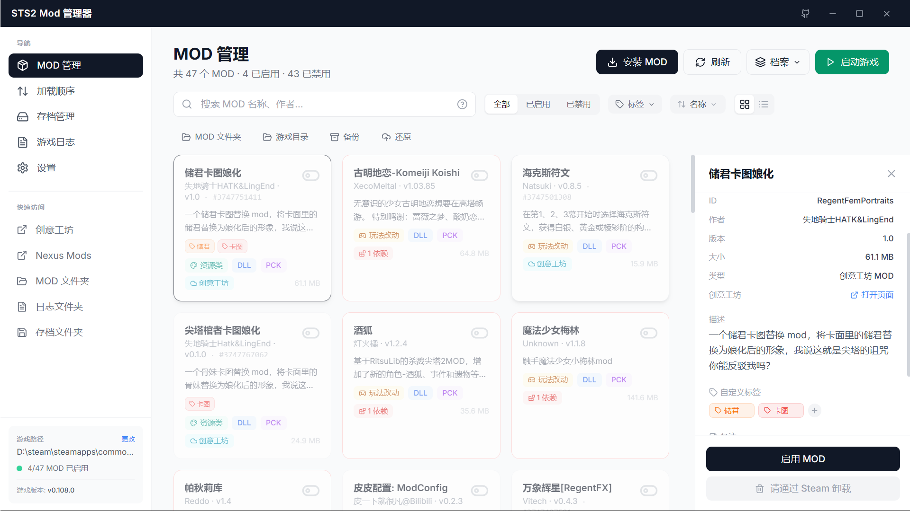
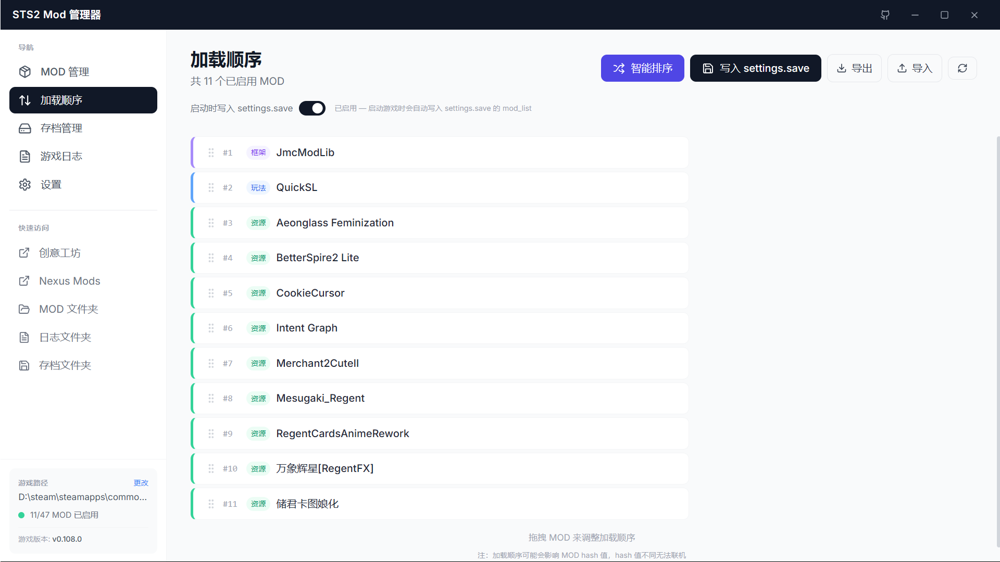

<div align="center">

# 🃏 STS2 Mod Manager

> 🌐 **中文版 README**：[docs/README.zh-CN.md](docs/README.zh-CN.md)

**A MOD manager for Slay the Spire 2 players**

No more manually copying folders. Install, remove, enable, disable — just drag & drop.

[](https://github.com/DZX66/sts2-mod-manager/releases)
[](https://github.com/DZX66/sts2-mod-manager)
[](LICENSE)

<br>



<br><br>



<br><br>


</div>

<br>

---

<br>

## ✨ Highlights

| | Feature | Description |
|---|---|---|
| 📦 | **MOD Management** | Install / uninstall / enable / disable, with drag-and-drop `.zip` installation |
| 🏷️ | **Risk Signals** | Automatically flags missing dependencies, and distinguishes framework prerequisites / gameplay-changing / asset-only MODs at a glance |
| 🔗 | **Dependency Jump** | Click a dependency in the detail panel to jump straight to that MOD |
| 🔀 | **Smart Sorting** | Sort by name / dependency issues first / gameplay impact / category / size |
| 🔢 | **Load Order** | Drag to adjust MOD load order and resolve load conflicts |
| 🔎 | **Tag Filtering** | Quickly filter MODs by tags, with support for custom tags and color markers |
| 🖼️ | **Dual View Modes** | Switch between card grid view (default) and two-column list view anytime; your last choice is remembered |
| 🧭 | **First-Run Guide** | A 3-step card-based onboarding: pick folder → install MODs → verify launch, beginner-friendly |
| ⚠️ | **Action Confirmation** | Risky operations (uninstall, batch uninstall, apply profiles, restore backups) ask for confirmation and explain the consequences first |
| 💾 | **Save Management** | Normal saves & MOD saves displayed separately, with one-click export backup, import restore, plus Blitz / multiplayer ascension and rotating win-streak badges |
| 📋 | **Game Logs** | View the latest logs in real time to pinpoint issues instantly |
| 🌐 | **MOD Translation** | Can't understand English descriptions? Translate them into Chinese with one click |
| ⚙️ | **Config Profiles** | Save MOD enablement schemes and switch between co-op / solo anytime |
| 🚀 | **Launch Game** | Supports both Steam and non-Steam versions with automatic detection |

<br>

> This repository is an enhanced fork of [ImogeneOctaviap794/sts2-mod-manager](https://github.com/ImogeneOctaviap794/sts2-mod-manager). It inherits all features from upstream and adds the following:

---

## ⭐ New Features (vs. upstream)

### 🌍 Multi-language Support (Localization)
<p>Full Chinese / English UI switching, built on React Context + JSON translation files — all UI strings are localized. Switch languages in the Settings page with no restart required.</p>

### 🎨 Dark / Light Theme
<p>Supports three theme modes: "Light", "Dark", and "Follow System". When set to follow the system, it automatically adapts to the Windows theme setting to protect your eyes.</p>

### ⚙️ Settings Page
<p>Centrally manage all preferences:<br>
- 🎨 Appearance theme switching<br>
- 🌐 UI language selection<br>
- 🎮 Game path configuration<br>
- 📦 Smart install toggle<br>
- 🔄 Steam user switching</p>

### 🧩 Steam Workshop Support
<p>Directly detects the current Steam user, scans the workshop subscription directory, and automatically brings workshop MODs under management. Workshop MODs are marked as such in the MOD list, with enable status, workshop ID display, and one-click open of the workshop page.<br>
The MOD detail page offers a <b>Backup to Local</b> button that copies the workshop MOD's files into a <code>[id]-backup</code> subfolder of the local mods folder.<br>
<sub>Uninstalling workshop MODs must be done through the Steam client.</sub></p>

### 🤖 Smart Install Mode
<p>Automatically analyzes the archive structure when installing MODs:<br>
- If the ZIP root directly contains MOD files, automatically creates a folder named after the MOD name + version<br>
- If the ZIP root is already a single folder, uses it directly<br>
- Smart mode can be turned off in the Settings page to use the traditional install method</p>

### 📝 MOD Notes
<p>Add text notes to each MOD from its detail page — handy for recording install reasons, caveats, compatibility issues, and more. Notes are persisted and survive manager restarts.</p>

### 🎯 Game Version Compatibility Check
<p>Parses the game's <code>release_info.json</code> to get the current game version and compares it against the <code>min_game_version</code> field in MOD manifests. If the game version is too old, a compatibility warning is shown on the MOD card and detail page to avoid crashes from loading incompatible MODs.</p>

### 📊 Improved Log Analysis
<p>Enhanced log analysis engine for more accurate identification of Error and Warning levels, more precise crash analysis reports to help pinpoint problematic MODs.</p>

### 🔄 New MOD Manifest Format Support
<p>Adapts to STS2's new MOD manifest format:<br>
- Supports the <code>min_game_version</code> version requirement field<br>
- Supports the new <code>dependencies</code> declaration format<br>
- Ignores leading <code>"v"</code> prefix in version numbers for wider compatibility</p>

### 🛠 Profile Switching Refactor
<p>Rewrote the config profile switching logic to fix MOD state inconsistencies in save management. When applying a profile, missing MODs and version mismatches are still reported, but applying now tries to enforce the profile as far as possible: MODs recorded as enabled are enabled regardless of version differences, MODs not present in the profile are disabled, and missing MODs are simply ignored.</p>

### 🔢 MOD Load Order Management
<p>Adjust MOD load order via drag-and-drop in a popup to resolve load conflicts between MODs.</p>

### 🏷️ Custom Tags
<p>Add custom tags with custom colors to each MOD. Combined with tag filtering, you can quickly filter MODs by any category — managing large MOD libraries has never been easier.</p>

### 🔔 Version Update Notifications
<p>Automatically checks the latest GitHub release when entering the Settings page. When a new version is found, an update window pops up showing the changelog so you can decide whether to upgrade.</p>

<br>

---

## 📥 Download

👉 [**Download the latest release here**](https://github.com/DZX66/sts2-mod-manager/releases)

> The installer is ~4MB with built-in WebView2 bootstrapping. Works directly on Win10 / Win11.

<br>

## 🚀 Getting Started

1. Double-click to open — the manager will automatically find your game
2. Can't find it? Click the bottom-left corner to manually pick the folder, just once
3. Install MODs — click "Install MOD" to choose files, or **drag & drop them into the window**
4. Play

<br>

## 🛠 Local Development

```bash
npm install              # Install dependencies
npm run tauri:dev        # Tauri dev mode
npm run tauri:build      # Tauri build
npm run dev              # Electron dev mode
```

> Tauri builds require [Rust](https://rustup.rs/) + [VS Build Tools](https://visualstudio.microsoft.com/visual-cpp-build-tools/) (select C++ desktop development)

<br>

## 📐 Tech Stack

```
Frontend  React 18 + TailwindCSS + Lucide Icons
Backend   Rust (Tauri v2)
Packaging NSIS installer (~4MB)
Alt       Electron version code also kept
```

<br>

## 📁 Project Structure

```
src/               Frontend source (React)
src-tauri/         Backend source (Rust)
dist-tauri/        Frontend build output
main.js            Electron main process
preload.js         Electron preload
docs/              Screenshots & assets
```

<br>

---

<div align="center">
<sub>MIT License · A ⭐ is the greatest support</sub>
<br>
<sub>Upstream repo: <a href="https://github.com/ImogeneOctaviap794/sts2-mod-manager">ImogeneOctaviap794/sts2-mod-manager</a></sub>
</div>